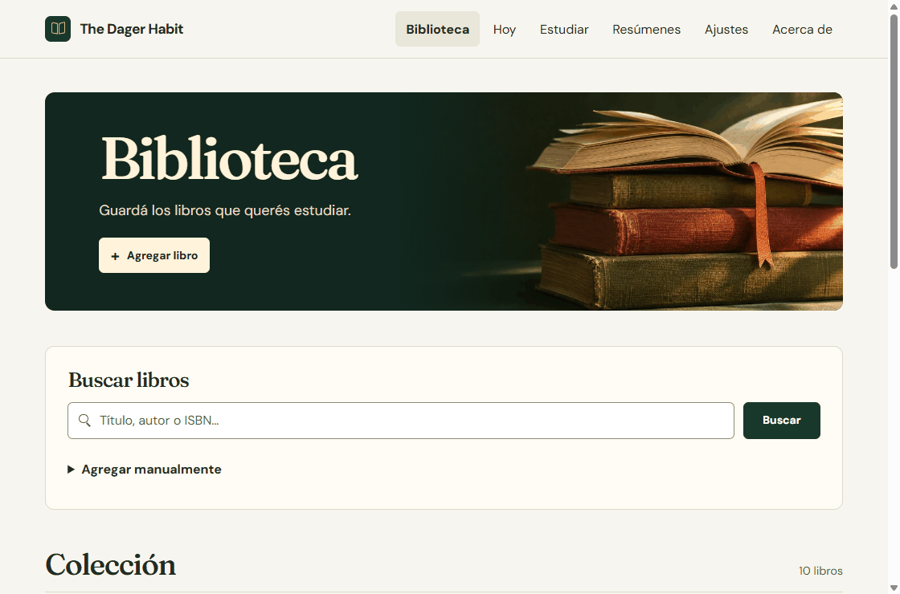

<div align="center">

# The Dager Habit

**Una app web instalable para organizar tus libros, estudiar con recuperación activa y recordar lo que leés con repasos espaciados.**



[](https://github.com/matiasdante/dager-habit/releases)
[](https://github.com/matiasdante/dager-habit/actions/workflows/ci.yml?query=branch%3Amain)
[](LICENSE)

[Inicio rápido](#inicio-rápido) · [Cómo funciona](#cómo-funciona) · [Preguntas frecuentes](#preguntas-frecuentes) · [Contribuir](CONTRIBUTING.md) · [Cambios](CHANGELOG.md)

</div>

## Inicio rápido

Con Docker Compose 2.24 o posterior, ejecutá esto desde la raíz del repositorio:

```sh
docker compose up --build --wait
```

Abrí [http://localhost:8080](http://localhost:8080). Si el puerto ya está ocupado, definí `HABIT_PORT` en un archivo `.env` en la raíz. Para apagar la app, ejecutá `docker compose down`.

La biblioteca y las sesiones funcionan sin claves. Si querés evaluaciones con IA, copiá [habit-api/.env.example](habit-api/.env.example) a `.env` en la raíz, elegí un proveedor y configurá sus credenciales y `HABIT_API_TOKEN`. Después de levantar el contenedor, ingresá ese token en **Ajustes**. En la [guía de la API](habit-api/README.md) están las variables de cada proveedor y la configuración de NotebookLM.

## Cómo funciona

1. Buscá por título, autor o capítulo en tu biblioteca. Para sumar un libro, buscá por título, autor o ISBN en Open Library y elegí la edición, o agregalo manualmente. Podés guardar la última página leída desde la colección y editar o archivar libros desde su ficha.
2. Empezá una sesión de 10 o 15 minutos. Prepará preguntas, leé, anotá lo que recordás y armá el examen para el repaso. Si pausás el temporizador, la app conserva el tiempo restante.
3. Volvé a **Hoy** para responder las preguntas pendientes o consultar los próximos siete días. Las respuestas en curso se guardan como borrador. El seguimiento usa días de Buenos Aires y un calendario de repaso de 2, 3, 5 y 7 días.

La interfaz es una PWA en Angular 22. La API en ASP.NET Core 10 sirve la web y conecta con Open Library, los proveedores de IA y, si lo configurás, NotebookLM Enterprise. El contenedor reúne la web y la API.

El proyecto toma como punto de partida las ideas de Dot Dager sobre lectura y estudio. [Cómo recordar todo lo que leés](https://www.youtube.com/watch?v=6Xij6NcnqLc)

## Preguntas frecuentes

**¿Dónde quedan mis datos?** La biblioteca, el avance y el estudio se guardan en el navegador. En **Ajustes** podés exportar un respaldo e importarlo en otro dispositivo. Cuando pedís una evaluación, la API envía el contenido que elegiste evaluar al proveedor configurado.

**¿Puedo instalarla o estudiar sin conexión?** Abrila en un navegador compatible y elegí **Instalar app**. Después de la primera carga, podés abrir la app y trabajar con tus datos locales sin conexión. El catálogo y las integraciones remotas requieren internet.

**¿Puedo usar NotebookLM personal?** Descargá el resumen de un libro desde **Resúmenes** e importalo en NotebookLM. La sincronización automática está disponible con una cuenta configurada para NotebookLM Enterprise.

## Desarrollo

La [guía de contribución](CONTRIBUTING.md) explica cómo correr la web y la API por separado, probar cambios y abrir un PR. El proyecto usa la [licencia MIT](LICENSE).
