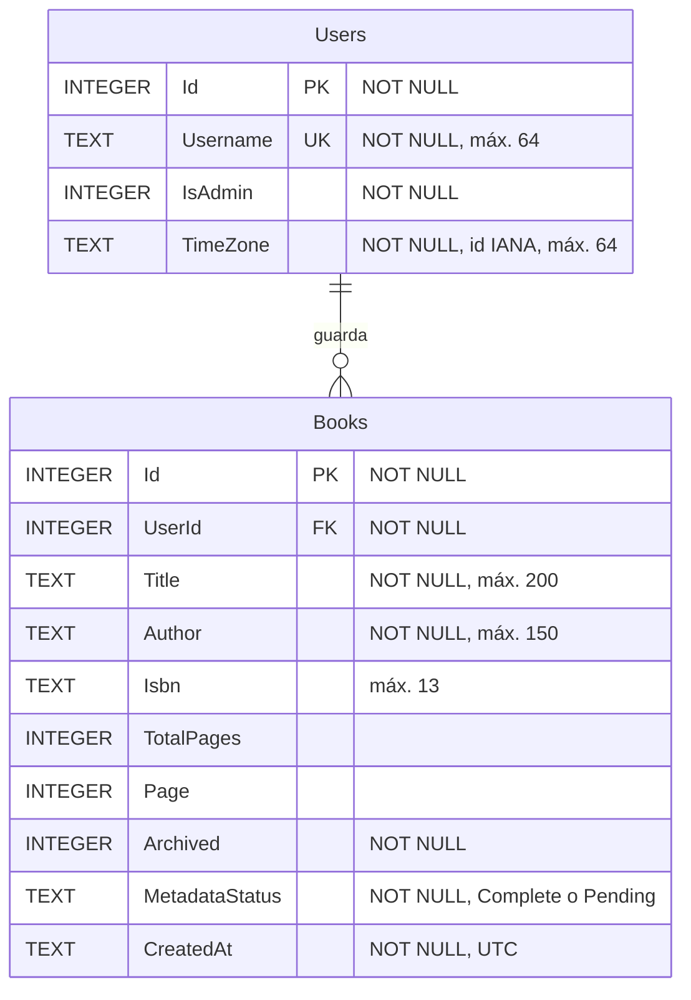

# Modelo de datos

SQLite en `habit.db`, dentro de `HABIT_DATA_DIR` (en Docker, el volumen `/app/data`). Las migraciones viven en `habit-api/Migrations`. Esta versión documenta lo que existe hoy; cada bloque del plan agrega sus tablas junto con su migración.

Toda tabla de datos personales lleva `UserId`. `HabitDb` aplica un filtro global por la persona de la petición, y con el login apagado esa persona es el usuario local (`Id = 1`, creado por la migración inicial).

